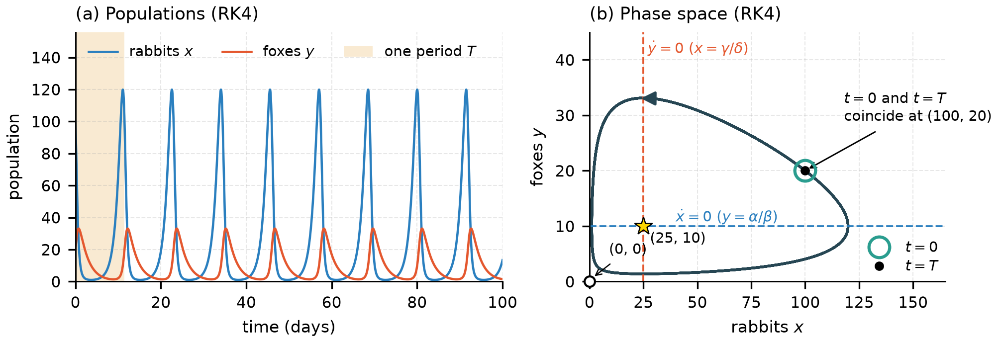

# Population dynamics: predator–prey and zombie outbreak models

Numerical solutions of two population models in Python, written as practice for the PH22007 Scientific Computing in Python coursework (past-year brief).

- **Lotka–Volterra (rabbits and foxes):** Euler vs fourth-order Runge–Kutta (RK4), fixed points and nullclines, the period of the orbit, and a quantitative comparison of the two methods (conserved-quantity drift and error against computational cost).
- **Zombie outbreak (humans, zombies, dead):** RK4 solution, the effect of the zombification rate γ on the outbreak time, and fits to the outbreak time. The outbreak time scales as 1/(γ − δ).
- **Extensions:** phase-space vector fields for both systems, and time-varying parameters (humans learning to fight back, and seasonal rabbit births).



## Running

```
pip install numpy scipy matplotlib
python population_dynamics.py
```

This takes about 30–40 seconds. It writes every figure to `figures/` as a 300 dpi PNG (drawn at A4 text width), and writes the key numbers to `figures/results_summary.txt`.

## Code layout

Everything is in [population_dynamics.py](population_dynamics.py):

- `euler()` and `rk4()`: generic fixed-step solvers for any system `f(t, u, p)`. They accept a batch of initial conditions or parameter values, so whole parameter sweeps run in a single loop.
- `lotka_volterra()` and `zombie()`: the model equations. Any parameter can be a constant or a function of time.
- One function per question (`question_1_1()`, `question_1_2()`, ..., `question_3b_seasonal()`), each producing one figure.

## Figures

| File | Contents |
|---|---|
| `q1_1_euler.png` | Euler solution: populations and phase-space spiral |
| `q1_2_rk4.png` | RK4 solution with nullclines, fixed points and one period marked |
| `q1_2_comparison.png` | Euler vs RK4: conserved-quantity drift and error against cost |
| `q2_1_zombies.png` | Zombie outbreak, with the logistic approximation |
| `q2_2a_gamma_sweep.png` | Varying γ, and the collapse onto one curve |
| `q2_2c_outbreak_fit.png` | Outbreak time against γ with fits and residuals |
| `q3a_vector_fields.png` | Vector fields for both systems |
| `q3b_learning.png` | Time-varying zombie destruction rate |
| `q3b_seasonal.png` | Seasonal forcing of the rabbit birth rate |
